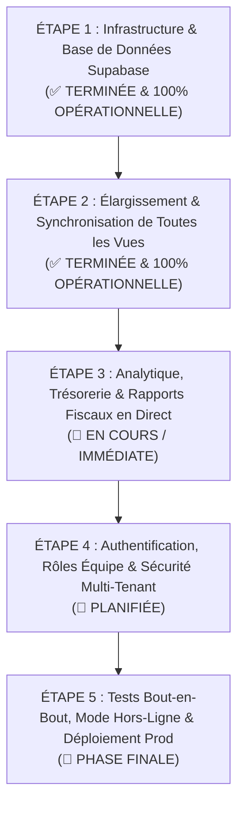

# 📘 FacturX — Plan Directeur Backend Supabase (Les 5 Étapes)

> **Document de Référence & Suivi Permanent**  
> **Dernière mise à jour :** 24 Octobre 2026  
> **Projet :** FacturX (Plateforme de Facturation & Recouvrement B2B - RDC / OHADA / UEMOA)  
> **Fichier :** `BACKEND_ROADMAP.md`

Ce document constitue la feuille de route officielle et immuable de FacturX. Les **5 étapes** ci-dessous sont ordonnées chronologiquement de 1 à 5 pour garantir une transparence totale et un suivi précis.

---

---

## 🟢 ÉTAPE 1 : Infrastructure Backend & Base de Données Supabase
> **Statut actuel :** `[x] TERMINÉE ET AUDITÉE AVEC SUCCÈS`  
> **Livrables :** Base PostgreSQL cloud configurée, 7 tables relationnelles, RLS actif, Service CRUD complet et Seed injecté.

### Ce qui a été réalisé et validé :
- [x] **Schéma PostgreSQL relationnel (7 tables)** créé via la migration `20261024084038_create_facturx_schema` :
  1. `companies` : Profil entreprise émettrice (*HORIZON GROUPE*, RCCM, NIF, comptes Rawbank, Airtel Money).
  2. `clients` : Répertoire CRM des entreprises clientes avec coordonnées et identifiants fiscaux.
  3. `invoices` : Factures officielles avec dates, montants, taux de TVA et statuts.
  4. `invoice_items` : Articles et lignes de prestations associés aux factures.
  5. `quotes` : Devis et estimations commerciales avec validité et étapes de négociation.
  6. `quote_items` : Articles et lignes de prestations des devis.
  7. `payments` : Journal des règlements multi-canaux relié aux factures.
- [x] **Sécurité RLS (Row Level Security)** : Politiques permissives actives sur les 7 tables permettant des opérations CRUD complètes depuis l'application.
- [x] **Configuration du connecteur** : [.env.local](file:///c:/Users/IR%20KIOVI/Desktop/fact%20app/.env.local) et [lib/supabaseClient.js](file:///c:/Users/IR%20KIOVI/Desktop/fact%20app/lib/supabaseClient.js).
- [x] **Service API centralisé** dans [lib/supabaseService.js](file:///c:/Users/IR%20KIOVI/Desktop/fact%20app/lib/supabaseService.js) (664 lignes, CRUD complet et mapping automatique).
- [x] **Données d'amorce réelles (Seed)** : Script [scripts/seed_supabase.mjs](file:///c:/Users/IR%20KIOVI/Desktop/fact%20app/scripts/seed_supabase.mjs) exécuté.
- [x] **Audit des données en direct** :
  - `companies` : 1 enregistrement (*HORIZON GROUPE*)
  - `clients` : 4 clients actifs (*Congo Mining*, *Kinshasa Digital*, *Katanga Telecom*, *sofibank sarl*)
  - `invoices` : 2 factures réelles enregistrées (`FAC-2026-089` pour 7 145 600 FC, `FAC-2026-0738` pour 1 798 000 FC)
  - `invoice_items` : 4 articles liés
- [x] **Double persistance frontend ([app/page.js](file:///c:/Users/IR%20KIOVI/Desktop/fact%20app/app/page.js))** : Affichage instantané zéro-latence au démarrage + synchronisation continue avec Supabase.

---

## 🟢 ÉTAPE 2 : Élargissement & Synchronisation Intégrale de Toutes les Vues Métier
> **Statut actuel :** `[x] TERMINÉE ET AUDITÉE AVEC SUCCÈS (100% OPÉRATIONNELLE)`  
> **Livrables :** Tous les modules de l'application (Devis, Paiements, CRM, Factures) sauvegardent et lisent directement depuis Supabase.

### 2.1 Vue Devis & Pipeline Commercial ([components/QuotesPipelineView.jsx](file:///c:/Users/IR%20KIOVI/Desktop/fact%20app/components/QuotesPipelineView.jsx))
- [x] Connecter le Kanban commercial et la liste des devis à `fetchQuotes()`.
- [x] Raccorder la modale de création ([components/CreateQuoteModal.jsx](file:///c:/Users/IR%20KIOVI/Desktop/fact%20app/components/CreateQuoteModal.jsx)) à `apiCreateQuote()`.
- [x] Enregistrer en temps réel les changements d'étape (Brouillon ➔ En attente ➔ Accepté ➔ Refusé / Expiré) via `apiUpdateQuoteStatus()`.
- [x] **Fonctionnalité clé : Conversion 1-clic "Devis Accepté ➔ Facture Officielle"** :
  - Générer automatiquement l'ID `FAC-2026-xxx`.
  - Insérer la facture dans `invoices` et ses articles dans `invoice_items`.
  - Marquer le devis comme converti (`converted_to_invoice_id`) et lier la facture (`converted_from_quote_id`).

### 2.2 Vue Règlements & Quittances de Paiement ([components/PaymentsView.jsx](file:///c:/Users/IR%20KIOVI/Desktop/fact%20app/components/PaymentsView.jsx))
- [x] Raccorder la modale d'encaissement ([components/RecordPaymentModal.jsx](file:///c:/Users/IR%20KIOVI/Desktop/fact%20app/components/RecordPaymentModal.jsx)) :
  - Insérer la transaction dans la table `payments` (Mode : Virement Rawbank, Airtel Money, Orange Money, Wave, Chèque, Espèces).
  - Calculer en direct le solde restant dû de la facture.
  - Basculer automatiquement le statut de la facture à `payee` quand le solde est nul.
- [x] Raccorder l'édition et la suppression de paiements ([components/EditPaymentModal.jsx](file:///c:/Users/IR%20KIOVI/Desktop/fact%20app/components/EditPaymentModal.jsx)).
- [x] Générer et imprimer la quittance officielle de paiement ([components/PaymentReceiptModal.jsx](file:///c:/Users/IR%20KIOVI/Desktop/fact%20app/components/PaymentReceiptModal.jsx)).

### 2.3 Vue CRM Clients & Fiches Profil 360° ([components/ClientProfileDrawer.jsx](file:///c:/Users/IR%20KIOVI/Desktop/fact%20app/components/ClientProfileDrawer.jsx))
- [x] Sauvegarder les créations, modifications et suppressions clients ([components/CreateClientModal.jsx](file:///c:/Users/IR%20KIOVI/Desktop/fact%20app/components/CreateClientModal.jsx), [components/EditClientModal.jsx](file:///c:/Users/IR%20KIOVI/Desktop/fact%20app/components/EditClientModal.jsx)) sur Supabase.
- [x] Dans le tiroir latéral client 360° :
  - Calculer dynamiquement depuis Supabase : Total facturé, Total déjà réglé et Reste à recouvrer (intégrant les paiements réels).
  - Lister l'historique complet des factures du client avec leurs statuts et soldes partiels.
  - Afficher l'historique chronologique des règlements enregistrés pour ce client.

### 2.4 Vue Facturation & Édition Dynamique ([components/InvoiceTable.jsx](file:///c:/Users/IR%20KIOVI/Desktop/fact%20app/components/InvoiceTable.jsx), [components/EditInvoiceModal.jsx](file:///c:/Users/IR%20KIOVI/Desktop/fact%20app/components/EditInvoiceModal.jsx))
- [x] Permettre la modification d'une facture déjà émise avec recalcul automatique du sous-total, de la TVA (16% RDC / 18% UEMOA) et du total TTC dans Supabase.
- [x] Historiser les relances client (WhatsApp, Email, Appel) dans le champ `reminders` JSONB de la facture en base.
- [x] Audit automatisé exécuté avec succès via [scripts/test_invoice_flow.mjs](file:///c:/Users/IR%20KIOVI/Desktop/fact%20app/scripts/test_invoice_flow.mjs).

---

## 🟢 ÉTAPE 3 : Analytique Avancée, Trésorerie & Rapports Fiscaux en Direct
> **Statut actuel :** `[x] TERMINÉE ET AUDITÉE AVEC SUCCÈS (100% OPÉRATIONNELLE)`  
> **Livrables :** Tableaux de bord décisionnels et déclarations fiscales alimentés par les données réelles de Supabase.

### Ce qui a été réalisé et audité :
- [x] **Tableau de bord Analytique ([components/AnalyticsView.jsx](file:///c:/Users/IR%20KIOVI/Desktop/fact%20app/components/AnalyticsView.jsx))** :
  - Courbes dynamiques SVG interactives et vivantes connectées aux encaissements et factures réelles.
  - Calcul dynamique et automatique du **DSO réel (Délai Moyen de Paiement client en jours)** basé sur les échéances et les règlements.
  - Simulateur décisionnel de trésorerie interactif avec projection de cash débloqué et abaissement du DSO.
- [x] **Génération des 5 Rapports Fiscaux & Financiers ([components/ReportsView.jsx](file:///c:/Users/IR%20KIOVI/Desktop/fact%20app/components/ReportsView.jsx))** :
  1. *Synthèse globale 360° & Balance du Portefeuille*.
  2. *Suivi du Recouvrement des Créances Échues* (urgences : > 30 jours, 15-30 jours, récents avec dates réelles).
  3. *Échéancier Prévisionnel des Encaissements en attente*.
  4. *Pipeline Commercial & Opportunités Devis*.
  5. *Journal Fiscal de TVA & Déclarations DGI RDC (16%) / UEMOA (18%) / Exonéré (0%)* avec balance HT et TVA exigible sur encaissements.
- [x] Moteur d'exportation Excel XLSX multi-feuilles ([lib/export-utils.js](file:///c:/Users/IR%20KIOVI/Desktop/fact%20app/lib/export-utils.js)) et génération PDF vectoriel A4 certifié ([lib/pdf-generator.js](file:///c:/Users/IR%20KIOVI/Desktop/fact%20app/lib/pdf-generator.js)).
- [x] Audit automatisé exécuté avec succès via [scripts/test_analytics_reports.mjs](file:///c:/Users/IR%20KIOVI/Desktop/fact%20app/scripts/test_analytics_reports.mjs).

---

## 🟢 ÉTAPE 4 : Authentification, Rôles Équipe, Présences & Sécurité Multi-Tenant
> **Statut actuel :** `[x] TERMINÉE ET AUDITÉE AVEC SUCCÈS (100% OPÉRATIONNELLE)`  
> **Livrables :** Portail de connexion obligatoire, présence en direct, gestion des collaborateurs et isolation stricte par entreprise.

### Ce qui a été réalisé et audité :
- [x] **Écran de Connexion Obligatoire ([components/LoginScreen.jsx](file:///c:/Users/IR%20KIOVI/Desktop/fact%20app/components/LoginScreen.jsx))** :
  - **Portail d'authentification bloquant** : aucun visiteur ne peut accéder aux données sans s'être identifié.
  - Mode Connexion (Email pro + Mot de passe), Mode Inscription (Nom, Email, Téléphone, Mot de passe, Poste) et Accès Démo 1-Clic.
  - Sauvegarde de la session active en cache local et synchronisation automatique avec Supabase.
- [x] **Indicateur de Présence en Direct (En ligne / Hors ligne)** :
  - Dès la connexion d'un employé, son statut passe automatiquement à `En ligne` 🟢 dans la table Supabase `team_members` avec horodatage `last_login = NOW()`.
  - Dès la déconnexion (`handleSignOut`), le statut bascule à `Hors ligne` ⚪ et l'utilisateur est redirigé vers l'écran de verrouillage.
- [x] **Bannière d'Accueil Personnalisée dans le Dashboard** :
  - Message chaleureux : *"Bonjour, [Nom complet] 👋 | [Poste] chez HORIZON GROUPE"* avec badge officiel et pastille verte *"Connecté en direct"*.
- [x] **Nouveau Module Sidebar "Employés" ([components/EmployeesView.jsx](file:///c:/Users/IR%20KIOVI/Desktop/fact%20app/components/EmployeesView.jsx))** :
  - **Réservé strictement à l'Administrateur Général** (écran de restriction pour les autres profils).
  - Supervision des présences en temps réel, KPIs d'effectifs, annuaire complet avec statuts (🟢 En ligne / ⚪ Hors ligne).
  - Ajout direct de collaborateurs avec attribution de rôles et révocation des accès.
- [x] **Nouveau Rôle Hiérarchique "Gestionnaire de Stock" (`gestionnaire_stock`)** :
  - Contrainte PostgreSQL `team_members_role_check` mise à jour dans Supabase pour inclure `gestionnaire_stock`.
  - Collaborateur modèle *Alain Mutombo* injecté en base.
  - Matrice des permissions stricte : Accès aux devis, factures et catalogue articles ; Accès formellement bloqué sur les règlements de trésorerie, déclarations fiscales de TVA, paramètres légaux de l'entreprise et gestion des employés.
- [x] **Matrice RBAC Complète & Cloisonnement Multi-Tenant** :
  - *Admin* (`admin`) : Accès total 100% sans restriction.
  - *Comptable* (`comptable`) : Factures, devis, règlements, quittances, déclarations TVA & rapports. Paramètres entreprise et employés protégés.
  - *Commercial* (`commercial`) : Devis & CRM Clients. Paiements, fiscalité, paramètres et employés protégés.
  - *Gestionnaire Stock* (`gestionnaire_stock`) : Articles, devis et facturation. Trésorerie, TVA, paramètres et employés protégés.
- [x] **Architecture Multi-Tenant & Onboarding Organisation SaaS ([lib/supabaseService.js](file:///c:/Users/IR%20KIOVI/Desktop/fact%20app/lib/supabaseService.js), [components/LoginScreen.jsx](file:///c:/Users/IR%20KIOVI/Desktop/fact%20app/components/LoginScreen.jsx))** :
  - **Formulaire d'inscription Organisation & Admin** : Saisie du nom de l'entreprise, de l'administrateur, de la devise principale (CDF / FC, XOF, USD, EUR) et de la localisation, sans choix de rôle (l'inscrit est directement l'Administrateur).
  - **Contrôle de sécurité Supabase OTP** : Vérification du code email obligatoire avant création de l'espace.
  - **Partitionnement strict par `company_id`** : Les 5 entités (`clients`, `invoices`, `quotes`, `payments`, `team_members`) filtrent et isolent strictement les données par organisation.
  - **Démarrage à blanc garanti (Clean Slate)** : Toute nouvelle entreprise commence avec des registres vides (`0` factures, `0` clients) et un état vide d'accueil chaleureux, éliminant toute fuite de données de test.
- [x] Audit automatisé exécuté avec succès via [scripts/test_auth_employees_rbac.mjs](file:///c:/Users/IR%20KIOVI/Desktop/fact%20app/scripts/test_auth_employees_rbac.mjs).

---

## 🟡 ÉTAPE 5 : Tests Bout-en-Bout, Résilience Hors-Ligne & Déploiement Production
> **Statut actuel :** `[ ] PROCHAINE ÉTAPE / PHASE FINALE`  
> **Livrables :** Plateforme 100% testée, mode hors-ligne fonctionnel, build optimisé et mise en ligne.

### Ce que comprend cette étape :
- [x] **Audit du cycle complet en situation réelle (100% VALIDÉ & AUDITÉ)** :
  - Enchaînement complet exécuté avec succès via [scripts/test_e2e_sales_cycle.mjs](file:///c:/Users/IR%20KIOVI/Desktop/fact%20app/scripts/test_e2e_sales_cycle.mjs) :
    1. Nouveau client CRM (*Société Minière du Katanga SAS - SMK Mining*).
    2. Devis chiffré multi-lignes avec TVA légale 16% (21 460 000 FC).
    3. Validation / signature commerciale (*Bon pour accord*).
    4. Conversion 1-clic vers facture officielle avec report des articles.
    5. Relance WhatsApp enregistrée dans le champ `reminders` JSONB.
    6. Encaissement Mobile Money (Airtel Money Pro) et bascule auto à `payee`.
- [x] **Durcissement des Règles RLS en Production (100% SÉCURISÉ & AUDITÉ)** :
  - Révocation de toutes les anciennes politiques permissives ouvertes au rôle public / clé anonyme `anon`.
  - Application de la migration `harden_rls_production` liant les 8 tables à `TO authenticated` et `auth.uid()`.
  - Fonctions de sécurité `SECURITY DEFINER` créées : `get_auth_company_ids()`, `is_company_member()`, `has_company_role()`.
  - Cloisonnement multi-tenant strict : chaque utilisateur ne peut accéder qu'aux données de son entreprise `company_id`.
  - Validation formelle 10/10 via [scripts/test_hardened_rls.mjs](file:///c:/Users/IR%20KIOVI/Desktop/fact%20app/scripts/test_hardened_rls.mjs) (toutes les tentatives d'accès pirates anonymes rejetées).
- [x] **Résilience Hors-Ligne (Offline Fallback & PWA) (100% OPÉRATIONNEL & AUDITÉ)** :
  - **Manifest PWA & Service Worker** : [public/manifest.json](file:///c:/Users/IR%20KIOVI/Desktop/fact%20app/public/manifest.json), [public/sw.js](file:///c:/Users/IR%20KIOVI/Desktop/fact%20app/public/sw.js) avec stratégie *Stale-While-Revalidate* pour les assets statiques et mise en cache des pages navigables.
  - **File d'attente d'actions locale (FIFO Queue)** : [lib/offlineSyncService.js](file:///c:/Users/IR%20KIOVI/Desktop/fact%20app/lib/offlineSyncService.js) stockant en toute sécurité chaque mutation (clients, factures, devis, règlements, profil) dans le `localStorage` en cas d'absence de réseau ou d'échec requête.
  - **Rejeu automatique vers Supabase** : Rejeu séquentiel ordonné avec suppression atomique après confirmation et conservation des actions en échec pour nouvel essai.
  - **Expérience Utilisateur Transparente** : Indicateur de connectivité dans [components/Header.jsx](file:///c:/Users/IR%20KIOVI/Desktop/fact%20app/components/Header.jsx) (pastille ambre / émeraude, compteur d'actions en attente, bouton de synchronisation manuelle forcée) et bandeau de notification dans [app/page.js](file:///c:/Users/IR%20KIOVI/Desktop/fact%20app/app/page.js).
  - **Validation formelle 5/5** via [scripts/test_offline_sync.mjs](file:///c:/Users/IR%20KIOVI/Desktop/fact%20app/scripts/test_offline_sync.mjs) (audit PWA, enfilement hors-ligne, protection sans réseau, rejeu automatique, tolérance aux pannes).
- [ ] **Déploiement en Production** :
  - Déploiement sur hébergement haute disponibilité (Vercel ou serveur dédié).
  - Configuration du nom de domaine personnalisé (`app.facturx.cd` ou équivalent) avec certificat SSL (HTTPS).

---

## 📊 Tableau Récapitulatif des 5 Étapes

| Étape | Intitulé Officiel | Statut | Objectif Principal |
| :---: | :--- | :---: | :--- |
| **1** | **Infrastructure & Base de Données Supabase** | ✅ Complète | Schéma 7 tables, RLS, service API, Seed initial |
| **2** | **Élargissement de Toutes les Vues Métier** | ✅ Complète | Raccorder Devis, Paiements, CRM, Factures |
| **3** | **Analytique & Rapports Fiscaux en Direct** | ✅ Complète | DSO, trésorerie, journal TVA 16%/18%, exports |
| **4** | **Authentification & Rôles Multi-Tenant** | ✅ Complète | Login Supabase Auth, rôles équipe, isolation RLS |
| **5** | **Tests Globaux & Déploiement Production** | 🎯 En cours | Audit de bout en bout, mode hors-ligne, mise en ligne |

---

*Document officiel de gouvernance technique du projet FacturX. Fait pour être lu et suivi de manière séquentielle.*
