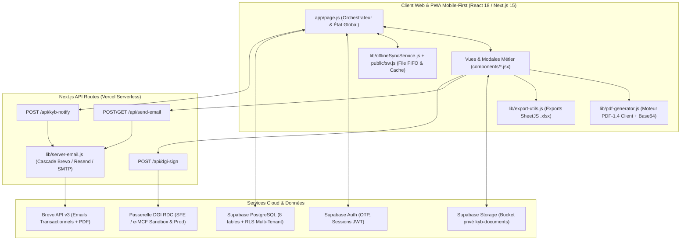
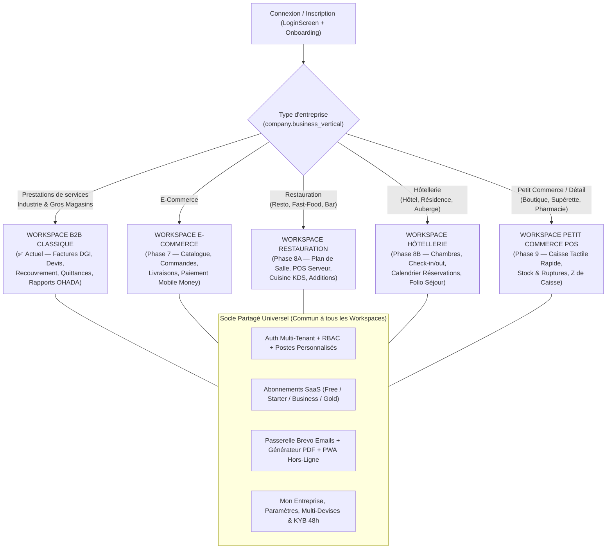

# FacturX — Architecture Complète & Roadmap du Projet (Du Début à la Fin)

> **Document Directeur d'Architecture & Feuille de Route Produit**  
> **Projet :** FacturX SaaS (`https://facturx-saas.vercel.app`)  
> **Dépôt :** `YAV-NEVIL/facturx-saas` (`main`)  
> **Dernière mise à jour :** 17 Novembre 2026

---

## 1. Vision Globale : D'un Outil de Facturation B2B à une Plateforme Multi-Métiers

**FacturX** a démarré comme une plateforme SaaS de facturation normalisée (DGI RDC / OHADA / UEMOA) et de recouvrement B2B.  
Avec l'avancement du projet, la vision finale consiste à proposer **une plateforme unique multi-tenant** qui, dès l'inscription ou le paramétrage de l'entreprise, **adapte automatiquement toute l'interface métier au type d'activité de l'utilisateur** :

1. **Workspace B2B Classique *(Livré à 100 %)* ** : Prestations de services, Agences, Entreprises industrielles, BTP, Transport/Logistique, Gros magasins / Grossistes.
2. **Workspace E-Commerce *(Phase 7)* ** : Boutiques en ligne, Vente sociale (WhatsApp/Instagram), Livraisons & Commandes.
3. **Workspace Restauration *(Phase 8A)* ** : Restaurants, Fast-foods, Bars, Cafés, Traiteurs.
4. **Workspace Hôtellerie *(Phase 8B)* ** : Hôtels, Appart-hôtels, Auberges, Résidences.
5. **Workspace Petit Commerce / Détail *(Phase 9)* ** : Boutiques, Supérettes, Pharmacies, Quincailleries, Points de vente POS.

Toutes ces interfaces partagent un **socle commun unifié** : Authentification Multi-Tenant Supabase, RBAC & Équipe, Abonnements SaaS, Multi-Devises, Emails transactionnels Brevo, Mode Hors-Ligne PWA, Mobile-First et Conformité Fiscale.

---

## 2. Tout ce qui a été réalisé du Début jusqu'à Maintenant (Phases 0 à 6.4)

### Chronologie complète des réalisations livrées en production

| Phase | Intitulé | Statut | Ce qui a été construit & vérifié |
| :---: | :--- | :---: | :--- |
| **0** | **Socle UI/UX & Design System** | ✅ Terminée | Next.js App Router, Tailwind CSS v3.4, police unique `Plus Jakarta Sans`, palette institutionnelle (`#F6F8FC`, `#2563EB`, Sidebar dégradée bleue), badges pilules normalisés (`AGENTS.md`, `GEMINI.md`). |
| **1** | **Infrastructure Backend Supabase** | ✅ Terminée | Schéma PostgreSQL relationnel (`companies`, `clients`, `invoices`, `invoice_items`, `quotes`, `quote_items`, `payments`, `team_members`), bucket privé `kyb-documents`, client & service API centralisé (`lib/supabaseService.js`). |
| **2** | **Suite Commerciale B2B Complète** | ✅ Terminée | Factures dynamiques (création, édition, aperçu, duplication), Devis en pipeline Kanban/Liste avec **conversion en facture en 1 clic**, CRM Clients 360° (`ClientProfileDrawer.jsx`), Enregistrement des règlements multi-canaux (Banque, Airtel Money, Orange Money, Wave, Cash) & Quittances officielles (`PaymentReceiptModal.jsx`). |
| **3** | **Analytique, Trésorerie & Moteur PDF/Excel** | ✅ Terminée | Courbes SVG animées, calcul réel du **DSO**, simulateur de trésorerie, 5 rapports financiers & journaux TVA (16% RDC / 18% UEMOA), export Excel `.xlsx` (`lib/export-utils.js`) et **générateur PDF-1.4 vectoriel natif sans dépendance** (`lib/pdf-generator.js`). |
| **4** | **Auth Multi-Tenant, RBAC & Équipe** | ✅ Terminée | Portail bloquant (`LoginScreen.jsx`), inscription Organisation + Admin avec OTP/lien email, partitionnement strict par `company_id`, matrice RBAC (`admin`, `comptable`, `commercial`, `gestionnaire_stock`), **postes personnalisés saisis manuellement** (`badge` libre), gestion des collaborateurs (`EmployeesView.jsx`) et présence en direct (`En ligne` / `Hors ligne`). |
| **5** | **Sécurité RLS, PWA Hors-Ligne, KYB 48h & Mobile-First** | ✅ Terminée | Durcissement RLS PostgreSQL (`harden_rls_production`), PWA complète (`public/manifest.json`, `public/sw.js`, file FIFO `lib/offlineSyncService.js`), portail KYB non-bloquant avec vérification sous 48h (`CompanyOnboardingGate.jsx`), uniformisation de la devise choisie partout, **refonte Mobile-First** (bottom-sheets scrollables sur toutes les modales, cartes mobiles) et persistance de l'onglet actif au rafraîchissement (`?tab=...` + `localStorage`). |
| **6.1** | **Facture Normalisée DGI RDC (SFE / e-MCF)** | ✅ Terminée | Champs NIM/ISF/Token dans Paramètres, groupes fiscaux A/B/C et types FV/FA/FP, route `/api/dgi-sign`, `lib/dgi-service.js`, **Code DEF/DGI** et **QR Code vectoriel 21×21** sur l'aperçu et le PDF. |
| **6.2** | **Tendances Hebdomadaires Réelles & KPIs Cliquables** | ✅ Terminée | Calcul dynamique des courbes `Sem 1` à `Sem 4` sur les dates réelles (`StatsCards.jsx`) et navigation directe vers les factures filtrées. |
| **6.3** | **Abonnements SaaS & Quotas** | ✅ Terminée | Moteur `lib/subscription-plans.js` & page `PricingView.jsx` avec 4 offres : **Free (0 $)**, **Starter (14 $)**, **Business (34 $)**, **Gold (Sur mesure)** + contrôle strict des quotas. |
| **6.4** | **Emails Transactionnels Réels Brevo & Invitations Équipe** | ✅ Terminée | Passerelle cascade `lib/server-email.js` (Brevo API v3 actif en prod, Resend, SMTP Nodemailer), `/api/send-email` & `/api/kyb-notify` : envoi réel avec **PDF joint** pour **Factures, Relances, Devis, Quittances et Rapports** (`DocumentEmailComposer.jsx`), notifications KYB, demandes Gold, **invitations collaborateurs avec mot de passe provisoire**, lien d'acceptation `?invite=...`, notifications cloche dans `Header.jsx` et compte Super-Admin basculé sur `facturx01@gmail.com`. |

---

## 3. Architecture Technique Actuelle (État Live en Production)

### 3.1 Architecture Système Globale

### 3.2 Cartographie Exacte des Fichiers Actuels

- **Routes & Pages (`app/`)** :
  - `app/page.js` : Contrôleur maître (session, persistance onglet `?tab=`, CRUD synchronisé Supabase + `localStorage`, notifications Header, routage des vues B2B).
  - `app/layout.js` & `app/globals.css` : Police `Plus Jakarta Sans`, thème clair/sombre, styles d'impression `@media print`.
  - `app/api/send-email/route.js` : Envoi d'emails réels (`invoice_pdf`, `quote_pdf`, `receipt_pdf`, `report_pdf`, `reminder`, `employee_invite`, `gold_inquiry`, `test`).
  - `app/api/kyb-notify/route.js` : Alertes et décisions KYB (`submitted`, `approved`, `rejected`).
  - `app/api/dgi-sign/route.js` : Signature fiscale normalisée SFE / e-MCF.
- **Composants (`components/` — 37 fichiers)** :
  - *Structure & Auth* : `Sidebar.jsx`, `Header.jsx`, `CalendarDropdown.jsx`, `LoginScreen.jsx`, `AuthModal.jsx`, `CompanyOnboardingGate.jsx`, `PWARegister.jsx`.
  - *Dashboard & Analytique* : `StatsCards.jsx`, `DashboardForecast.jsx`, `DashboardRecentInvoices.jsx`, `InvoiceMetricsBar.jsx`, `AnalyticsView.jsx`, `ReportsView.jsx`, `ReportPreviewModal.jsx`.
  - *Factures, Devis, Paiements & Clients* : `InvoiceTable.jsx`, `CreateInvoiceModal.jsx`, `EditInvoiceModal.jsx`, `InvoiceDetailModal.jsx`, `QuotesPipelineView.jsx`, `CreateQuoteModal.jsx`, `QuoteDetailModal.jsx`, `PaymentsView.jsx`, `RecordPaymentModal.jsx`, `EditPaymentModal.jsx`, `PaymentReceiptModal.jsx`, `CreateClientModal.jsx`, `EditClientModal.jsx`, `ClientProfileDrawer.jsx`, `ClientReminderModal.jsx`.
  - *Transversal, Équipe & SaaS* : `DocumentEmailComposer.jsx`, `EmployeesView.jsx`, `PricingView.jsx`, `SettingsView.jsx`, `ConfirmationModal.jsx`, `ExportModal.jsx`, `CountrySelect.jsx`, `PhoneCountryInput.jsx`.
- **Services & Librairies (`lib/`)** :
  - `lib/supabaseClient.js`, `lib/supabaseService.js` (CRUD complet, Auth, KYB, Multi-Tenant), `lib/offlineSyncService.js`, `lib/dgi-service.js`, `lib/pdf-generator.js`, `lib/export-utils.js`, `lib/server-email.js`, `lib/subscription-plans.js`, `lib/mock-data.js`.

---

## 4. Architecture Cible Multi-Activités (De Maintenant jusqu'à la Fin du Projet)

### 4.1 Principe de Routage Intelligent par Type d'Entreprise

Dès l'inscription (`LoginScreen.jsx`) ou le paramétrage (`CompanyOnboardingGate.jsx`), l'utilisateur sélectionne son **Type d'Activité (`business_vertical`)**.  
Ce choix détermine **l'interface métier complète** dans laquelle l'utilisateur atterrit après connexion, tout en conservant le même compte, la même sécurité RLS, le même abonnement et les mêmes services emails/PDF :

### 4.2 Détail Technique des Nouvelles Verticales (Phases 7 à 10)

#### 🟡 Phase 7 — Architecture & Refonte du Portail Secteur + Workspace **E-Commerce**
1. **Sélecteur de Type d'Activité dès la création du compte** :
   - Ajout du champ `business_vertical` (`b2b_services` | `ecommerce` | `restaurant` | `hotel` | `retail_pos`) dans la table Supabase `companies` (avec rétrocompatibilité : les entreprises existantes restent sur `b2b_services`).
   - Écran de choix visuel par cartes claires dans `LoginScreen.jsx` (inscription) et `CompanyOnboardingGate.jsx` :
     - *Services, Industrie & Gros Commerce* → Interface B2B actuelle.
     - *E-Commerce* → Interface E-Commerce.
     - *Restauration* → Interface Restauration.
     - *Hôtellerie* → Interface Hôtellerie.
     - *Petit Commerce / Détail* → Interface Caisse & Stock POS.
   - Création d'un routeur de workspace (`components/workspaces/WorkspaceRouter.jsx`) dans `app/page.js` qui charge la navigation (`Sidebar`) et les vues propres à `companyInfo.businessVertical`.
2. **Modules du Workspace E-Commerce** :
   - **Dashboard E-Commerce** : Commandes du jour, panier moyen, chiffre d'affaires encaissé vs paiement à la livraison (COD), taux de livraison réussie.
   - **Catalogue Produits & Stock** (`ecommerce_products`) : Nom, SKU, prix, stock disponible, variantes (taille/couleur), visuel produit, statut actif/rupture.
   - **Gestion des Commandes** (`ecommerce_orders`, `ecommerce_order_items`) : Pipeline *Nouvelle → Confirmée → En préparation → En livraison → Livrée / Annulée*, adresse client, téléphone WhatsApp, mode de paiement (Mobile Money, Carte, Cash à la livraison).
   - **Livraisons & Coursiers** : Attribution livreur, suivi des frais de livraison par zone, preuve de livraison.
   - **Reçu / Bordereau de Commande PDF & Email Brevo** : Envoi automatique du récapitulatif de commande et du reçu client.

#### 🟠 Phase 8A — Workspace **Restauration** (Restaurants, Fast-Foods, Bars, Traiteurs)
1. **Tables Supabase dédiées** : `restaurant_tables`, `menu_items`, `kitchen_orders`, `kitchen_order_items`.
2. **Modules du Workspace Restauration** :
   - **Plan de Salle & Tables** : Vue interactive des tables (*Libre*, *Occupée*, *Addition demandée*) + commandes *À emporter / Livraison*.
   - **Prise de Commande POS Serveur (Mobile-First)** : Sélection rapide par catégories de menu (*Plats, Boissons, Desserts, Menus*), quantités, notes cuisine (*sans piment*, *cuisson*).
   - **Écran Cuisine / Bar (KDS)** : Vue temps réel des bons en attente → en préparation → prêts à servir.
   - **Addition & Encaissement** : Division de note entre convives, pourboire, encaissement Cash / Mobile Money, impression ou envoi du ticket/facture.

#### 🟣 Phase 8B — Workspace **Hôtellerie** (Hôtels, Résidences, Auberges)
1. **Tables Supabase dédiées** : `hotel_rooms`, `hotel_reservations`, `hotel_folio_charges`.
2. **Modules du Workspace Hôtellerie** :
   - **Tableau des Chambres** : Statut temps réel (*Disponible, Occupée, À nettoyer, Maintenance*), type de chambre (Standard, Suite, VIP), tarif nuitée.
   - **Calendrier & Réservations** : Création réservation, Check-in, Check-out, gestion des acomptes et prolongation de séjour.
   - **Folio Client (Note de Séjour)** : Addition automatique des nuitées + extras consommés (Restaurant, Blanchisserie, Navette, Minibar) avec génération de facture normalisée DGI/OHADA et quittance au départ.

#### 🟢 Phase 9 — Workspace **Petit Commerce / Commerce de Détail (POS)**
1. **Tables Supabase dédiées** : `retail_products`, `retail_sales`, `retail_sale_items`, `cash_registers`.
2. **Modules du Workspace Petit Commerce** :
   - **Caisse Rapide Tactile (POS Mobile-First)** : Catalogue visuel/recherche instantanée (ou scan code-barres caméra mobile), ajout au panier en 1 tap, calcul automatique du total et de la monnaie à rendre.
   - **Encaissement Instantané & Crédit Client** : Paiement Cash, Mobile Money ou mise sur compte client (carnet de dettes suivi avec relances WhatsApp).
   - **Stock Simplifié & Marges** : Entrées de stock, alertes seuil critique / date d'expiration, suivi Prix d'achat vs Prix de vente (marge brute réelle).
   - **Clôture de Caisse Journalière (Z de Caisse)** : Synthèse des encaissements du jour par caissier et par canal, exportable en PDF.

#### 🔵 Phase 10 — Finalisation Production, Sécurité & Mise à l'Échelle *(Limite Finale de l'Application)*
Cette phase marque **l'aboutissement complet de FacturX v2.0** prêt pour une exploitation commerciale à grande échelle :
1. **Sécurisation API Serveur** : Vérification obligatoire du jeton JWT Supabase (`Authorization: Bearer`) sur `/api/send-email`, `/api/kyb-notify` et `/api/dgi-sign`, plus limitation anti-abus (rate limiting).
2. **Paiements SaaS Automatisés** : Connexion d'une passerelle de paiement réelle (Mobile Money RDC/UEMOA & Cartes via Flutterwave / CinetPay / Stripe) dans `PricingView.jsx` avec webhooks de renouvellement automatique.
3. **Domaine Pro & Délivrabilité Email Maximale** : Liaison du domaine personnalisé (ex. `app.facturx.cd`) sur Vercel, configuration DNS SPF/DKIM/DMARC sur Brevo, et branchement du Custom SMTP Brevo dans Supabase Auth pour que même les codes OTP arrivent depuis `@facturx.cd`.
4. **Tests E2E Multi-Verticales & Monitoring** : Suite de tests bout-en-bout couvrant les 5 workspaces + monitoring des erreurs et performances en production.

---

## 5. Synthèse de l'Avancement & Prochaine Action Immédiate

```mermaid
flowchart LR
    P0["Phases 0–3 ✅\nUI, Supabase, Factures,\nDevis, PDF & Rapports"] --> P4["Phases 4–5 ✅\nAuth Multi-Tenant, RBAC,\nPWA, KYB & Mobile-First"]
    P4 --> P6["Phase 6.1–6.4 ✅\nDGI RDC, Tarifs SaaS,\nBrevo & Invitations"]
    P6 --> P7["Phase 7 🎯\nSélecteur d'Activité +\nWorkspace E-Commerce"]
    P7 --> P8A["Phase 8A\nWorkspace Restauration\n(Tables, POS, Cuisine)"]
    P8A --> P8B["Phase 8B\nWorkspace Hôtellerie\n(Chambres, Séjours, Folio)"]
    P8B --> P9["Phase 9\nWorkspace Petit Commerce\n(Caisse POS, Stock, Z)"]
    P9 --> P10["Phase 10 🏁\nSécurité JWT, Paiements SaaS,\nDomaine Pro & Tests E2E"]
```

### Résumé clair pour démarrer la suite
- **Où nous sommes aujourd'hui** : Toutes les fondations techniques, la sécurité Multi-Tenant, l'écosystème email Brevo, la conformité DGI RDC, le SaaS Pricing et **100 % du Workspace B2B Classique** (Services, Industrie, Gros Commerce) sont terminés et déployés sur `https://facturx-saas.vercel.app`.
- **Où nous allons jusqu'à la fin** :
  1. **Étape suivante immédiate (Phase 7)** : Mettre en place le **routeur par type d'entreprise** dès l'inscription/onboarding (`business_vertical`) afin que :
     - *Services / Industrie / Gros Magasins* → continuent d'ouvrir l'interface B2B actuelle ;
     - *E-Commerce* → ouvre le nouveau **Workspace E-Commerce** dédié ;
     - puis construire successivement les workspaces **Restauration (Phase 8A)**, **Hôtellerie (Phase 8B)** et **Petit Commerce POS (Phase 9)**, avant le verrouillage final **Phase 10** (sécurité JWT API, paiement SaaS, domaine pro).
